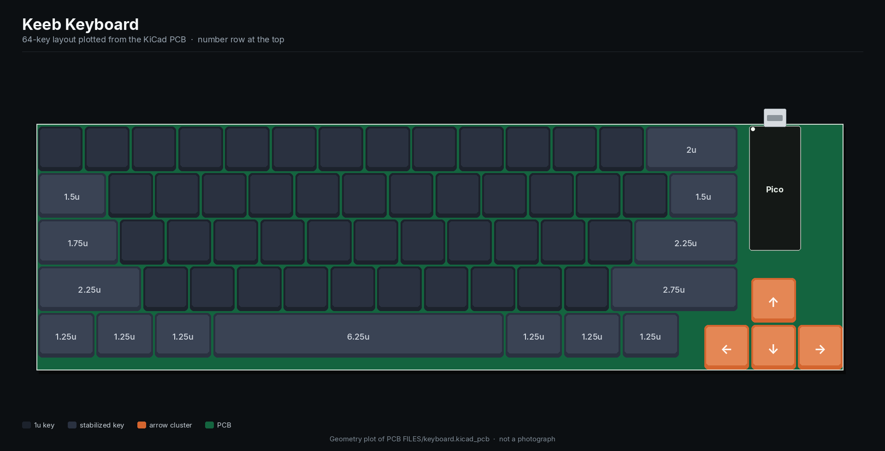
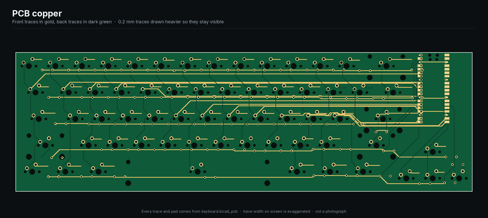
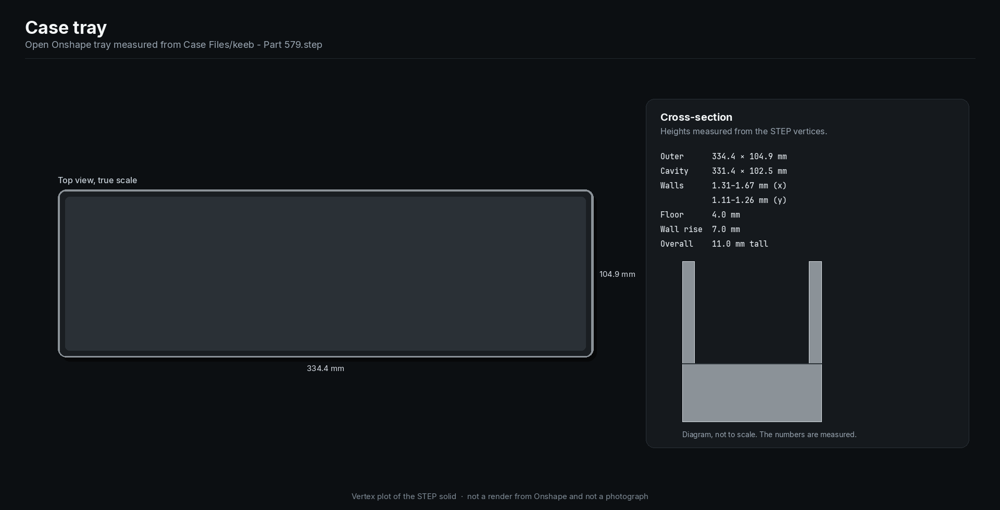

# Keeb Keyboard

A 64-key open-source mechanical keyboard: an ANSI 60% layout, a 4-key arrow cluster, a Raspberry Pi Pico, and a glue-in case. The schematic, PCB, Gerbers, and STEP file are the whole project.

[](LICENSE)
[](https://www.kicad.org/)
[](#layout)
[](#matrix-pinout)
[](https://keeb.hackclub.com/)

Built for [Hack Club KEEB](https://keeb.hackclub.com/), a you-ship-we-ship mechanical keyboard project. This was Ryan Editraj's first PCB: a 60% he extended with arrow keys, routed in KiCad, with the Pico soldered on the front and the case modeled in Onshape.

## Demo

This repository has no firmware and no app, so there is no device screen to capture. KiCad 10 is not installed in a stock Ubuntu image, and these pictures were **plotted from the design files** by [`scripts/render_previews.py`](scripts/render_previews.py). They are not photographs and not exports from KiCad's 3D viewer.







In KiCad's default Y-up view the number row sits toward the bottom of the canvas. The plots above put that row at the top, which is how the board sits on a desk. USB leaves the far edge.

## Features

* **64 MX-style keys.** 60 keys in an ANSI 60% unit layout, plus four 1u arrow keys stepped in on the right.
* **Cherry MX PCB-mount footprints** from KiCad's keyboard library, in 1u, 1.25u, 1.5u, 1.75u, 2u, 2.25u, 2.75u, and 6.25u.
* **One diode per switch.** 64 DO-35 through-hole diodes (the KEEB parts list uses 1N4148). Cathodes face the rows, which is COL2ROW.
* **Five PCB-mount stabilizers** from marbastlib: 2u under the 2u, 2.25u, and 2.75u keys, and 6.25u under the spacebar.
* **Raspberry Pi Pico** on the common module footprint (Pico, Pico W, or Pico 2 pinout). It sits on the front of the board, in the top-right bay, with USB-C hanging off the top edge.
* **5 × 17 keyboard matrix** (ROW0–ROW4, COL0–COL16) on GP0–GP21. 64 of the 85 positions are filled.
* **Two-layer, 1.6 mm board.** 575 traces, almost all through-hole, so the design only needs two vias.
* **Fabrication outputs included.** Gerbers and Excellon drills in `PCB FILES/Output.zip`, exported from KiCad 10.0.4.
* **Onshape case.** A single open tray, about 334 × 105 × 11 mm, meant to be glued with PE foam in the bottom. No plate and no mounting holes.

## Layout

Unit sizes below are read from the footprints. The schematic does not store key legends, so this README does not invent a QWERTY print. The sizes themselves match an ANSI 60%.

| Row | Keys | Widths, left to right |
| --- | --- | --- |
| 0 | 14 | 13 × 1u, 2u |
| 1 | 14 | 1.5u, 12 × 1u, 1.5u |
| 2 | 13 | 1.75u, 11 × 1u, 2.25u |
| 3 | 12 | 2.25u, 10 × 1u, 2.75u |
| 4 | 7 | 1.25u × 3, 6.25u, 1.25u × 3 |
| Arrows | 4 | 1u up, then 1u left / down / right, set slightly below the right side |

The Pico occupies the empty bay to the right of rows 0–2, above the arrow cluster.

## Tech stack

| Piece | Choice |
| --- | --- |
| Schematic and PCB | [KiCad](https://www.kicad.org/) 10.0.4 |
| Switch footprints | `Switch_Keyboard_Cherry_MX:SW_Cherry_MX_PCB_*` |
| Stabilizers | [marbastlib](https://github.com/ebastler/marbastlib) `STAB_MX_2u` and `STAB_MX_6.25u` |
| Diodes | `Device:D_Small` on `Diode_THT:D_DO-35_SOD27_P7.62mm_Horizontal` |
| Microcontroller | Raspberry Pi Pico, `Module:RaspberryPi_Pico_Common_Unspecified` |
| Case | Onshape, exported as STEP AP242 |
| Firmware | Not in this repo yet. [KEEB's firmware guide](https://keeb.hackclub.com/docs/firmware/) points at RMK. Any scanner that can drive a COL2ROW matrix can use the pinout below. |
| CI | GitHub Actions runs `scripts/check_design.py` (Python stdlib only) |

## Quick start

1. Install [KiCad 10](https://www.kicad.org/) or newer. Older KiCad releases will not open the files.
2. Install marbastlib. In KiCad's Plugin and Content Manager, add `https://raw.githubusercontent.com/ebastler/ebastler-KiCad-repository/main/repository.json`, then install **marbastlib**. The KEEB doc [Designing the PCB](https://keeb.hackclub.com/docs/pcb-design/) has the click path.
3. Open the two design files directly. There is no `.kicad_pro` in the repo.

```text
PCB FILES/keyboard.kicad_sch
PCB FILES/keyboard.kicad_pcb
```

4. Check that the files still match the reviewed design:

```bash
python3 scripts/check_design.py
```

5. To redraw the pictures in `docs/images/`:

```bash
pip install pillow
python3 scripts/render_previews.py
```

No environment variables are required. See [.env.example](.env.example).

## Usage

### Read the board

Switches are `SW1`–`SW64`, diodes `D1`–`D64`, stabilizers `ST14`, `ST41`, `ST42`, `ST53`, and `ST58`, and the Pico is `A1`. Rows and columns are global labels (`ROW0`–`ROW4`, `COL0`–`COL16`).

### Order the PCB

`PCB FILES/Output.zip` is a KiCad 10.0.4 fabrication set:

| File | Layer |
| --- | --- |
| `keyboard-F_Cu.gbr` / `keyboard-B_Cu.gbr` | Front and back copper |
| `keyboard-F_Mask.gbr` / `keyboard-B_Mask.gbr` | Solder mask |
| `keyboard-F_Silkscreen.gbr` / `keyboard-B_Silkscreen.gbr` | Silkscreen |
| `keyboard-F_Paste.gbr` / `keyboard-B_Paste.gbr` | Paste (empty of parts; this is a through-hole board) |
| `keyboard-Edge_Cuts.gbr` | Board outline, 328.5 × 100.5 mm |
| `keyboard-PTH.drl` / `keyboard-NPTH.drl` | Plated and non-plated drills |

Ask the fab for a 2-layer, 1.6 mm board. Traces are 0.2 mm and the two vias are a 0.3 mm drill in a 0.6 mm pad, so check the fab's minimums before you order. Details are in [SECURITY.md](SECURITY.md#design-notes-that-are-not-code-vulnerabilities).

### Bill of materials

| Qty | Refs | Part | Footprint |
| --- | --- | --- | --- |
| 64 | SW1–SW64 | MX-compatible PCB-mount switch | Cherry MX PCB, see the layout table for sizes |
| 64 | D1–D64 | Small-signal diode, DO-35 (KEEB uses 1N4148) | Horizontal, 7.62 mm pitch |
| 4 | ST14, ST41, ST42, ST53 | PCB-mount MX stabilizer, 2u | marbastlib `STAB_MX_2u` |
| 1 | ST58 | PCB-mount MX stabilizer, 6.25u | marbastlib `STAB_MX_6.25u` |
| 1 | A1 | Raspberry Pi Pico (Pico W and Pico 2 fit the same footprint) | Common Pico module |
| 1 | — | Keycaps to match the unit sizes | — |
| 1 | — | Case tray, or print/cut your own from the STEP | Onshape part |

The schematic symbol for the diode is `D_Small`, not a locked manufacturer part number. Match the DO-35 footprint.

### Matrix pinout

Diode footprint pin 1 is the cathode and lands on the row. The switch connects the column to the diode anode. Drive columns, read rows (COL2ROW).

GPIO names are the official Raspberry Pi Pico pinout for these pad numbers. The unused pads in the KiCad footprint use that same numbering (`GPIO22-Pad29`, `GPIO26_ADC0-Pad31`, and so on).

| Net | Pico pin | GPIO |
| --- | --- | --- |
| ROW0 | 1 | GP0 |
| ROW1 | 2 | GP1 |
| ROW2 | 4 | GP2 |
| ROW3 | 5 | GP3 |
| ROW4 | 6 | GP4 |
| COL0 | 7 | GP5 |
| COL1 | 9 | GP6 |
| COL2 | 10 | GP7 |
| COL3 | 11 | GP8 |
| COL4 | 12 | GP9 |
| COL5 | 14 | GP10 |
| COL6 | 15 | GP11 |
| COL7 | 16 | GP12 |
| COL8 | 17 | GP13 |
| COL9 | 19 | GP14 |
| COL10 | 20 | GP15 |
| COL11 | 21 | GP16 |
| COL12 | 22 | GP17 |
| COL13 | 24 | GP18 |
| COL14 | 25 | GP19 |
| COL15 | 26 | GP20 |
| COL16 | 27 | GP21 |

Pico pins 3, 8, 13, 18, 23, 28, and 38 are ground and are tied together on the module footprint. GP22, the ADC pins, RUN, 3V3, and VBUS stay on the module. That is what you want when the Pico's own regulator and USB connector do the power.

### Open the case

Import `Case Files/keeb - Part 579.step` into Onshape, Fusion 360, or FreeCAD. The solid is one open tray: 334.4 × 104.9 × 11.0 mm outside, with a cavity 331.4 × 102.5 mm, a 4 mm floor, and walls that rise 7 mm. Wall thickness is uneven, about 1.3–1.7 mm along the length and 1.1–1.3 mm along the depth. The PCB (328.5 × 100.5 mm) drops into that cavity. The original plan is glue plus PE foam, which matches a board with no mounting holes.

## Project structure

```text
.
├── PCB FILES/
│   ├── keyboard.kicad_sch    # schematic, KiCad 10
│   ├── keyboard.kicad_pcb     # 2-layer board
│   └── Output.zip             # Gerbers and drills
├── Case Files/
│   └── keeb - Part 579.step   # Onshape tray
├── docs/images/               # plots generated from those files
├── scripts/
│   ├── check_design.py        # CI check, stdlib only
│   └── render_previews.py     # rebuild the plots (needs Pillow)
├── .github/                   # CI, issue forms, pull request template
├── LICENSE                    # MIT
├── CONTRIBUTING.md
├── CODE_OF_CONDUCT.md
├── SECURITY.md
└── .env.example               # no secrets; nothing reads this
```

Folder names keep the spaces they were published with.

## Roadmap

* Firmware and a keymap (RMK, KMK, or QMK) that uses the pinout above.
* A photo of the soldered board, once it exists. The plots in this README are not a stand-in for that.
* Mounting holes, if the case moves off glue and foam.
* A plate, if the tray gets a top half.
* A design-rule pass before the next fab order: 0.2 mm traces, 0.3 / 0.6 mm vias, and the tight outline.
* Hotswap sockets. The footprints today are soldered PCB-mount MX.

## FAQ

### What is Keeb Keyboard?

Keeb Keyboard is an open-source 64-key mechanical keyboard design by Ryan Editraj. It is a KiCad PCB for a Raspberry Pi Pico, plus an Onshape case, published for Hack Club KEEB.

### Is this a 60% keyboard?

The alpha block is a 60-key ANSI 60% (right shift is 2.75u, so there is no extra 1u key beside it). Four arrow keys bring the switch count to 64. It is not a 65% or a 75%.

### Which microcontroller does it use?

A Raspberry Pi Pico, soldered on the front of the board in the top-right bay. The footprint also fits a Pico W or a Pico 2. The matrix uses GP0 through GP21. Wireless pins are unused.

### What switches and diodes does the PCB use?

MX-compatible PCB-mount switches in Cherry MX footprints, one DO-35 small-signal diode per switch, and PCB-mount MX stabilizers on the wide keys. The KEEB build guide uses 1N4148 diodes for this footprint.

### How do I open the design files?

Install KiCad 10 or newer and marbastlib, then open `PCB FILES/keyboard.kicad_sch` and `PCB FILES/keyboard.kicad_pcb`. There is no KiCad project file to double-click.

### How do I flash the firmware?

You can't yet. Firmware is not in the repository. The [matrix pinout](#matrix-pinout) is the map a firmware needs. Hack Club's guide recommends [RMK](https://keeb.hackclub.com/docs/firmware/).

### Can I manufacture this board?

Yes. The Gerbers and drills are in `PCB FILES/Output.zip`. It is a 2-layer, 1.6 mm, through-hole keyboard PCB, 328.5 × 100.5 mm. Read the fabrication notes before ordering: thin traces, small vias, no mounting holes.

### What is the case file?

`Case Files/keeb - Part 579.step` is a single Onshape tray, roughly 334 × 105 × 11 mm, sized to hold the PCB with glue and PE foam. It is not a full sandwich case and it has no switch plate.

### Are there API keys or secrets in the repository?

No. The design files, Gerbers, STEP file, and git history were scanned. Nothing needs to be rotated. Manufacturing files are public on purpose.

### Who is allowed to build or modify this?

Anyone. The design is MIT licensed. Keep the copyright notice if you redistribute it.

### Who made this?

Ryan Editraj, while learning schematic capture, PCB layout, and CAD for Hack Club KEEB. The Pico is on the front of the board because mounting it on the back was not obvious yet, and the journaling habit started late in the build.

## Contributing

See [CONTRIBUTING.md](CONTRIBUTING.md). Small, specific pull requests are the useful ones: a footprint fix, a regenerated Gerber zip, firmware that matches this matrix, or a clearer note. Please follow the [Code of Conduct](CODE_OF_CONDUCT.md).

## License

[MIT](LICENSE) © 2026 Ryan Editraj.

## Author

**Ryan Editraj** — AI builder and tech creator.

* GitHub: [github.com/ryaneditraj](https://github.com/ryaneditraj)
* Instagram: [instagram.com/ryaneditraj](https://instagram.com/ryaneditraj)
